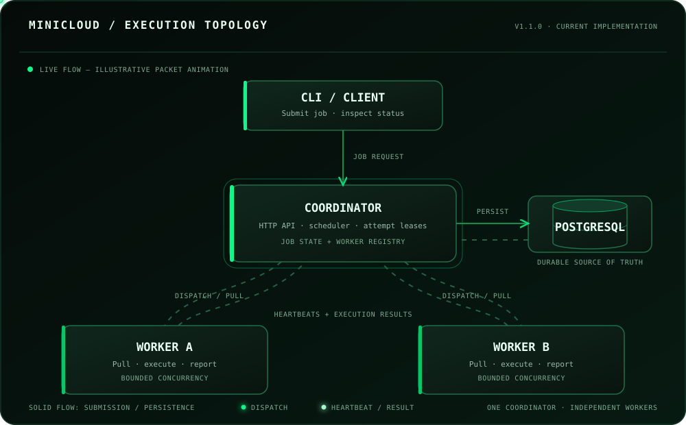
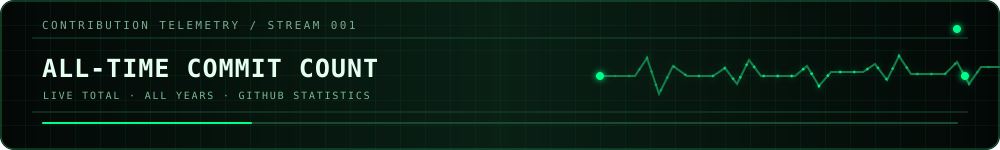

<!-- PROFILE README: BlaZe08-Dev -->

<div align="center">



<br/>

**Engineer first. Curious by default. Always building.**

<p>
  <a href="https://github.com/BlaZe08-Dev"></a>
  
  <a href="https://github.com/BlaZe08-Dev/MiniCloud"></a>
</p>

<code>AI & DATA SCIENCE</code> &nbsp;·&nbsp; <code>SOFTWARE ENGINEERING</code> &nbsp;·&nbsp; <code>DISTRIBUTED SYSTEMS</code>

<br/>


</div>

## ⟡ 00 — THE BUILDER'S LOG

I'm **Neelesh Malakar**, an AI & Data Science undergraduate who enjoys building practical software and understanding the systems underneath it.

My interests sit at the intersection of **backend engineering, distributed systems, full-stack development and applied AI**. I learn by shipping projects, investigating failure modes and improving the architecture—not just by collecting frameworks.

| CURRENT INTERESTS | HOW I APPROACH BUILDING |
|:---|:---|
| Distributed systems & backend architecture | Understand the constraints before choosing the design |
| AI integration & developer tooling | Use AI where it adds measurable value |
| Full-stack applications | Build complete workflows, not disconnected screens |
| Systems thinking & reliability | Test assumptions, document trade-offs and learn from failures |

<blockquote>
  <strong>My engineering principle:</strong> Don't just make it work. Understand why it works, where it breaks, and what it takes to make it dependable.
</blockquote>

## ◉ 01 — THE CORE SYSTEM

<div align="center">

<a href="https://github.com/BlaZe08-Dev/MiniCloud">
  
</a>
&nbsp;

&nbsp;


### Distributed Job Execution Platform

**MiniCloud** is my individual Go-based project exploring the engineering realities of distributed job execution: coordination, worker capacity, durable state, leases, retries and recovery.

</div>

**What is implemented**
- A coordinator service that accepts jobs, registers workers, tracks heartbeats and dispatches attempts.
- Independent worker processes that pull and execute allowlisted tasks with bounded concurrency.
- PostgreSQL as the durable source of truth for jobs, attempts, workers and execution records.
- A CLI for job submission, status inspection, attempt history and worker-capacity monitoring.
- Assignment-based round-robin and FIFO-pull dispatch policies, bounded retries and lease-based attempt handling.

**Animated architecture**

<div align="center">



<sub>Moving packets illustrate job submission, worker dispatch, heartbeats, execution results and durable-state updates. This is the current v1.1.0 topology—not a future-state design.</sub>

</div>

**Engineering note:** MiniCloud v1.1.0 is a learning-oriented, pre-production system. It is not multi-tenant and its API/worker endpoints do not yet provide authentication, authorization or TLS. It must not be exposed to untrusted networks. AI-assisted dispatch and coordinator failover remain post-V1 design ideas, not implemented capabilities.

<div align="center">

[](https://github.com/BlaZe08-Dev/MiniCloud)

</div>

## ⌘ 02 — PROJECT FIELDNOTES

A selection of individual and collaborative work. Team projects are labelled as collaborative; repository ownership does not imply sole authorship.

### ↳ 01 / INDEPENDENT BUILDS

<table>
<tr>
<td width="50%" valign="top">

<strong>01 / MINICLOUD</strong>

<sub>GO · DISTRIBUTED SYSTEMS</sub>

A distributed job-execution platform built to explore coordinator/worker orchestration, durable job state, dispatch policies and failure handling.

<a href="https://github.com/BlaZe08-Dev/MiniCloud">SOURCE ↗</a>

</td>
<td width="50%" valign="top">

<strong>02 / HARMONIQ</strong>

<sub>PYTHON · FLASK · JAVASCRIPT · JAMENDO API</sub>

A music discovery and playback web app with search, queue and playlist workflows, playback controls, recently played tracks and a responsive listening interface.

<a href="https://github.com/BlaZe08-Dev/Harmoniq">SOURCE ↗</a> · <a href="https://harmoniq-yvun.onrender.com">LIVE DEMO ↗</a>

</td>
</tr>
</table>

### ↳ 02 / TEAM-ENGINEERED BUILDS

<sub>Built with Raunak and other teammates. Contributions are collaborative, not presented as solo projects.</sub>

<table>
<tr>
<td width="50%" valign="top">

<strong>03 / KAVACH PAY</strong>

<sub>NEXT.JS · NODE / HONO · POSTGRESQL · FRAUD RISK</sub>

A simulated UPI-style payment experience with a deterministic fraud-risk engine that explains suspicious payment and collect-request signals in plain language. Hackathon prototype; payment rails and data are synthetic.

<a href="https://github.com/raunaksahahere/kavachPay">SOURCE ↗</a>

</td>
<td width="50%" valign="top">

<strong>04 / WEBTHREATDETECTION</strong>

<sub>CYBERSECURITY · REACT · PYTHON · WEB3</sub>

An evidence-based investigation tool for suspicious URLs, messages, raw emails and QR codes, with explainable findings and an on-chain report-integrity registry.

<a href="https://github.com/raunaksahahere/webThreatDetection">SOURCE ↗</a>

</td>
</tr>
<tr>
<td width="50%" valign="top">

<strong>05 / ROGUESIGNAL</strong>

<sub>MULTIPLAYER · GAME SYSTEMS · SOCIAL DEDUCTION</sub>

A first-person multiplayer social-deduction game concept for 4–10 players, built around roles, tasks, sabotage and proximity-based interaction.

<a href="https://github.com/raunaksahahere/RogueSignal">SOURCE ↗</a>

</td>
<td width="50%" valign="top">

<strong>06 / LOOPSPILL</strong>

<sub>REMOTE SENSING · SATELLITE DATA · AIS</sub>

A satellite-based oil-spill investigation workflow combining radar detection, backward drift modelling and vessel/AIS attribution to estimate likely spill origins.

<a href="https://github.com/raunaksahahere/LoopSpill">SOURCE ↗</a>

</td>
</tr>
<tr>
<td width="50%" valign="top">

<strong>07 / LOOPSATELLITE</strong>

<sub>EARTH OBSERVATION · TIME SERIES · GEOSPATIAL AI</sub>

A wetland-monitoring system for the East Kolkata Wetlands. Deterministic satellite-derived water measurements and seasonal anomaly detection support evidence-backed investigation.

<a href="https://github.com/raunaksahahere/LoopSatellite">SOURCE ↗</a>

</td>
<td width="50%" valign="top">

<strong>08 / JOCKY</strong>

<sub>COLLABORATIVE PROJECT · PRIVATE REPOSITORY</sub>

A collaborative project. The repository is private, so implementation details are intentionally not expanded here.

<a href="https://github.com/raunaksahahere/JOCKY">REPOSITORY LINK ↗</a>

</td>
</tr>
</table>

## ⬡ 03 — THE ENGINEERING TOOLCHAIN

<div align="center">

<sub>TOOLS AND TECHNOLOGIES I'VE WORKED WITH THROUGH PROJECTS AND PRACTICE</sub>

<table>
<tr>
<td width="33%" align="center" valign="top">

<strong>01 / LANGUAGES</strong>

<sub>Core programming</sub>

<br/><br/>


</td>
<td width="33%" align="center" valign="top">

<strong>02 / APPLICATIONS</strong>

<sub>Web and backend</sub>

<br/><br/>


</td>
<td width="33%" align="center" valign="top">

<strong>03 / SYSTEMS & TOOLS</strong>

<sub>Data and workflow</sub>

<br/><br/>


</td>
</tr>
</table>

<code>GO</code> <code>PYTHON</code> <code>FULL-STACK</code> <code>POSTGRESQL</code> <code>LINUX</code> <code>GIT</code>

</div>

## ▤ 04 — CONTRIBUTION TELEMETRY

<div align="center">



<sub>THE COUNTER BELOW USES ALL-TIME COMMITS, NOT JUST THIS YEAR.</sub>


<br/>


</div>

## ⌁ 05 — OPEN CHANNELS

<div align="center">

<a href="mailto:neeleshmalakar@gmail.com"></a>
<a href="https://www.linkedin.com/in/neeleshmalakar/"></a>
<a href="https://www.instagram.com/neels_archive/"></a>
<a href="https://medium.com/@Neelesh08"></a>
<a href="https://www.credly.com/users/neelesh-malakar"></a>
<a href="https://github.com/BlaZe08-Dev"></a>

<br/><br/>

```bash
$ echo "Keep building. Keep questioning. Keep engineering."
```

<strong><code>[ SYSTEM STATUS: ALWAYS BUILDING ]</code></strong>


</div>

<!-- END PROFILE README -->
